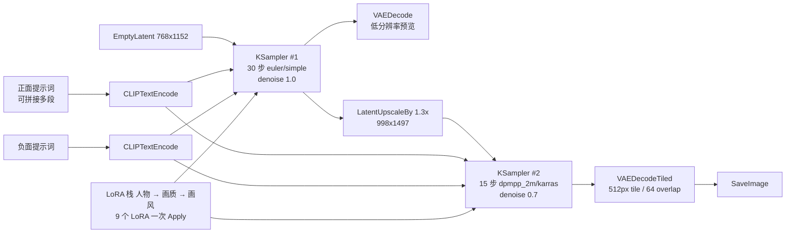

# ComfyUI · Anima on RX 5700 XT

**在 RDNA1（gfx1010）显卡上跑通 Anima 动漫模型的可复现工作流与调优笔记。**


-orange)


**中文** · [English](README.en.md)

---

## 这是什么

一份**实际跑得起来**的 ComfyUI 工作流，目标平台是 AMD RX 5700 XT（RDNA1 / gfx1010 / 8 GB 显存）+ Windows + ROCm。

RDNA1 不在 ROCm 官方验证清单里，网上现成的工作流基本都假设 12 GB 以上显存和 N 卡。这个仓库把「能跑通」的那些非默认选择固定下来：

- 用的是 **gfx101x 专用 nightly wheel**，不是官方 release 版 ROCm
- 工作流按 **8 GB 显存**切分：768×1152 底图 → 1.3× 潜空间放大 → 分块 VAE 解码
- 9 个 LoRA 用 Easy-Use 的 loraStack 串联，**一次 Apply**，而不是 9 个 LoraLoader 串成一条链

附带实测性能数据、踩过的报错，以及每一步为什么这么设。

## 环境

| 项目 | 版本 |
|---|---|
| GPU | AMD Radeon RX 5700 XT，8 GB VRAM（`gfx1010`） |
| OS | Windows 10 / 11 |
| Python | 3.12.10（embedded） |
| PyTorch | `2.9.1+rocm7.12.0a20260207`（HIP 7.2.0） |
| ROCm wheel | `rocm_sdk_core` + `rocm_sdk_libraries_gfx101x_dgpu` |
| ComfyUI | v0.34.4 |
| 系统内存 | 16 GB（建议 32 GB） |

> 显存 8 GB 是这个配置的核心约束，所有参数都是被它逼出来的。

## 仓库结构

```
.
├── workflows/
│   └── anima_rdna1_txt2img_hires.json   # 主工作流（直接拖进 ComfyUI 即可）
├── models/
│   └── README.md                        # 模型 / LoRA 清单与放置路径
├── scripts/
│   ├── launch_rdna1.bat                 # 启动脚本（含 ROCm 相关环境变量）
│   └── check_env.py                     # 环境自检：版本 / 显存 / 模型是否齐
├── config/
│   └── extra_model_paths.yaml.example   # 多磁盘模型路径示例
└── docs/
    ├── 01-environment.md                # ROCm on Windows 安装步骤
    ├── 02-performance.md                # 8 GB 显存下的性能取舍
    ├── 03-troubleshooting.md            # 报错 → 原因 → 解决
    └── 04-workflow-parameters.md        # 节点级参数说明
```

## 快速开始

### 1. 装后端

Windows 上的 ROCm 没有"一键安装",要用 AMD 的 SDK wheel + 对应编译的 torch。完整步骤见 **[docs/01-environment.md](docs/01-environment.md)**，核心就三条：

```bat
python -m pip install rocm_sdk_core-*.whl rocm_sdk_libraries_gfx101x_dgpu-*.whl
python -m pip install torch-2.9.1+rocm*.whl torchvision-*.whl torchaudio-*.whl
python -c "import torch; print(torch.cuda.get_device_name(0))"
```

最后一行必须打印出 `AMD Radeon RX 5700 XT`，否则不要往下走。

### 2. 放模型

模型文件名带 `Anima\` 子目录，请按 **[models/README.md](models/README.md)** 放到位。缺模型时工作流不会报错，只会静默用错文件 —— 所以先跑自检：

```bat
python scripts\check_env.py
```

### 3. 跑起来

```bat
scripts\launch_rdna1.bat
```

浏览器打开 `http://127.0.0.1:8188`，把 `workflows/anima_rdna1_txt2img_hires.json` 拖进画布，点 Run。

需要两个自定义节点包（**先装，否则节点全红**）：

| 节点 | 来自 |
|---|---|
| `easy loraStack` / `easy loraStackApply` | [ComfyUI-Easy-Use](https://github.com/yolain/ComfyUI-Easy-Use) |
| `ShowText\|pysssss` | [ComfyUI-Custom-Scripts](https://github.com/pythongosssss/ComfyUI-Custom-Scripts) |

其余节点都是 ComfyUI 自带的。

## 工作流结构

两段采样 + 潜空间放大，这是 8 GB 卡上画质和耗时的平衡点：



几个不是随手设的点：

- **两段采样而不是一段**。底图用 `euler/simple` 快速成形，放大后用 `dpmpp_2m/karras` + `denoise 0.7` 补细节。直接一步跑到 1497 高会让每步耗时翻倍，总时间反而更长。
- **放大用潜空间而不是像素空间**。`LatentUpscaleBy` 不额外占显存，适合 8 GB。
- **分块 VAE 解码**。`VAEDecodeTiled(512, 64, 64, 8)` 把解码峰值显存从 3 GB 级压到 1 GB 以内，代价是十几秒。
- **LoRA 串联后统一 Apply**。3 个 `loraStack` 首尾相接成一条链（人物 → 画质 → 画风），最后只过一个 `loraStackApply`。比 9 个 `LoraLoader` 串联少 8 次模型包装，冷启动明显更快。

## 实测性能

RX 5700 XT 8 GB，768×1152 → 1.3× 放大，9 个 LoRA：

| 场景 | 耗时 |
|---|---|
| 单张完整出图（30 + 15 步） | **约 12–13 分钟** |
| 其中采样阶段（25 步进度条） | 10:47 – 13:13（**26 – 32 秒/步**） |
| 首次冷启动（含 MIOpen kernel 编译） | 额外 +5 – 10 分钟 |

结论很直白：**耗时几乎全部在采样步数上，是线性的**。想快就减步数，别指望换 attention 后端能救。分析见 [docs/02-performance.md](docs/02-performance.md)。

## 已知限制

- `comfy-kitchen` 的 HIP 后端在 gfx1010 上不可用（`architecture is not in the validated target manifest`），自动回落到 eager 实现。这不是配错，是没编译。
- 启动时 `[WARNING] offload-arch failed with return code 1` 属正常现象，不影响推理。
- RDNA1 没有 `memory efficient attention`，长提示词下显存增长比 N 卡更陡。
- 16 GB 系统内存容易在切换模型时被撑爆，建议 32 GB。

## License

文档与脚本以 MIT 发布。工作流中的模型与 LoRA 各有其原始授权，不在本仓库范围内。
